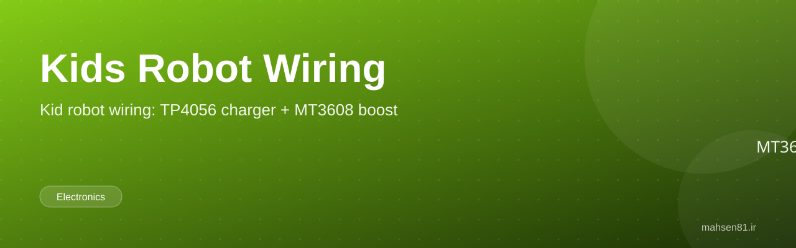
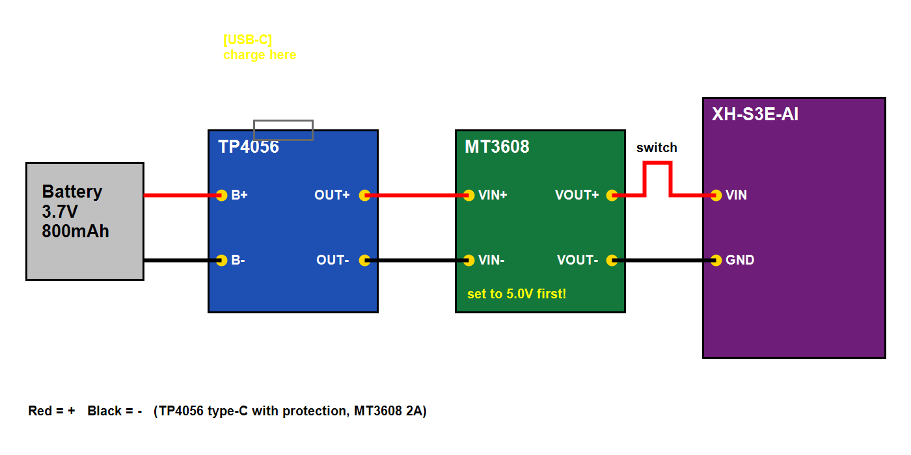

<!-- gen:header -->
<p align="center"></p>

<h1 align="center">Kids Robot Wiring</h1>
<p align="center"><b>طرح سیم‌کشی ربات کودک با شارژ TP4056 و MT3608</b><br><i>Kid robot wiring: TP4056 charger + MT3608 boost</i></p>
<p align="center"></p>

<div dir="rtl">

## ✨ امکانات

- نقشه‌ی سیم‌کشی علامت‌گذاری‌شده
- مدار شارژ و افزایش ولتاژ

</div>

## 📸 تصاویر · Screenshots

<p align="center"> </p>

## 🚀 Quick start

```bash
See wiring_tp4056_mt3608.png
```

---

<p align="center">ساخته‌شده توسط <a href="https://mahsen81.ir"><b>محسن جباره‌اصل</b></a> — برنامه‌نویسی، طراحی سایت، ربات و هوش مصنوعی<br>
Built by <a href="https://mahsen81.ir">Mohsen Jabbareh-Asl</a> · ⭐ اگر مفید بود، ستاره بدهید · Need a custom version? <a href="https://mahsen81.ir">Get in touch</a></p>
